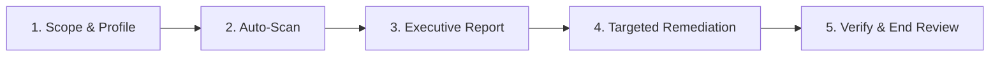

# Kỹ Năng Đánh Giá & Rà Soát Toàn Diện Dự Án NRO (Project Audit Engine)

> **Triết lý**: *"Không đoán mò, không đưa lời khuyên chung chung. Tìm ra vấn đề thật, định lượng mức độ nguy hại, cung cấp giải pháp sửa tận gốc và kết thúc review có kiểm chứng."*

---

## 1. Ma Trận Phân Cấp Mức Độ (Severity Matrix)

Mọi phát hiện trong quá trình Audit bắt buộc phải được gắn một trong 4 cấp độ:

| Mức Độ | Ký Hiệu | Ý Nghĩa Thực Tế | Thời Hạn Xử Lý |
| :--- | :---: | :--- | :--- |
| **CRITICAL** | 🔴 **P0** | Nguy cơ sập Server/Client ngay lập tức, Dupe đồ quy mô lớn, Rò rỉ Connection Pool sập DB MySQL, Lệch stream opcode làm crash game. | **Sửa ngay lập tức** trước khi tiếp tục. |
| **HIGH** | 🟠 **P1** | Tràn số âm điểm sức mạnh/vàng, Race condition khi đổi map/khu, Mất item khi disconnect bất ngờ, Deadlock khóa luồng. | **Ưu tiên hàng đầu** trong phiên làm việc. |
| **MEDIUM** | 🟡 **P2** | Cấp phát GC trong vòng lặp vẽ Client làm tụt FPS mobile, Tên cột MySQL thiếu backtick tiềm ẩn lỗi MySQL 8, Thiếu asset đĩa gây warning console. | Khắc phục theo lô (batch fix). |
| **LOW / INFO**| 🟢 **P3** | Code smells, dead code, logic lặp lại, magic numbers chưa khai báo hằng số, tối ưu hóa thuật toán. | Ghi chú dọn dẹp khi refactor. |

---

## 2. Quy Trình Rà Soát 5 Pha (The 5-Phase Audit Loop)



### Pha 1: Xác Định Phạm Vi Rà Soát (Scope & Profile)
Chọn chế độ quét phù hợp với mục tiêu:
```bash
# Quét toàn bộ dự án (Full System Audit - 6 Chiều)
python .agents/skills/nro-audit/scripts/audit_scanner.py --all

# Quét chuyên sâu bảo mật & chống dupe
python .agents/skills/nro-audit/scripts/audit_scanner.py --security

# Quét lệch stream nhị phân Server ↔ Client
python .agents/skills/nro-audit/scripts/audit_scanner.py --protocol

# Quét rò rỉ Database & JDBC
python .agents/skills/nro-audit/scripts/audit_scanner.py --database

# Quét hiệu năng & Zero-GC Client Unity
python .agents/skills/nro-audit/scripts/audit_scanner.py --client
```

### Pha 2: Bóc Tách Vấn Đề Thật (Deep Scan)
Bộ công cụ `audit_scanner.py` sẽ tự động phân tích:
1. **Security Scanner**: Quét các hàm xử lý Item (`Combine`, `Trade`, `ConsignShop`, `Box`) thiếu `synchronized` hoặc lock item.
2. **Protocol Integrity**: Quét danh sách opcode ở `Command.java` / `Controller.java` đối chiếu với Client C#.
3. **Database Inspector**: Quét toàn bộ lệnh `executeQuery` / `executeUpdate` không nằm trong `try-with-resources`, thiếu backtick MySQL 8 (`rank`, `group`, `order`).
4. **Numeric Safety**: Quét các trường `hp`, `dame`, `power`, `gold` trong `NPoint`, `Player`, `Inventory` còn dùng `int` thay vì `long`.
5. **Zero-GC Sentinel**: Quét code C# Unity trong `paint()`, `update()` phát hiện `new` đối tượng hoặc nối chuỗi `+`.
6. **Asset Reality**: Rà soát tài nguyên âm thanh/ảnh khai báo trong code so với file thực tế trên đĩa.

### Pha 3: Báo Cáo Đánh Giá (Executive Report)
Trình bày kết quả theo bảng phân loại:
- **Tọa độ**: `File:Line`
- **Triệu chứng & Kịch bản xảy ra lỗi**: Mô tả rõ người chơi hoặc hệ thống sẽ bị lỗi như thế nào.
- **Mức độ**: P0, P1, P2, P3.
- **Nguyên nhân gốc rễ (Root Cause)**.

### Pha 4: Khắc Phục Có Mục Tiêu (Targeted Remediation)
- Tra cứu mẫu code sửa chuẩn hóa tại `references/remediation-catalog.md`.
- Trình bày phương án **Before / After Diff** cho User phê duyệt.
- Tuân thủ nguyên tắc: *"Chỉ sửa đúng class và method then chốt (dưới 100 dòng mỗi lần)"*.

### Pha 5: Xác Minh & Kết Thúc Rà Soát (Verify & End Review)
Khi hoàn tất khắc phục hoặc khi User yêu cầu **End Review**:
1. **Biên dịch Java Server**: Chạy `build.bat` xác minh không có lỗi compile.
2. **Bảo toàn Invariant**: Chạy `python tools/memory/guardrails.py --check-all` đạt 100% PASS.
3. **Lưu trữ Bài Học**: Chạy `python tools/memory/memory.py capture ...` nếu có phát hiện quan trọng.
4. **Xuất Báo Cáo Tổng Kết**: Lưu tệp `AUDIT_SUMMARY_<timestamp>.md` vào artifacts để User lưu trữ.
5. Tuyên bố kết thúc phiên review an toàn.

---

## 3. Lệnh Thao Tác Nhanh (Cheat Sheet)

```bash
# 1. Chạy quét nhanh toàn bộ
python .agents/skills/nro-audit/scripts/audit_scanner.py --all

# 2. Xuất báo cáo dạng Markdown lưu trữ
python .agents/skills/nro-audit/scripts/audit_scanner.py --all --export-markdown "AUDIT_REPORT.md"

# 3. Kết thúc review & xác minh guardrails
python tools/memory/guardrails.py --check-all
```

