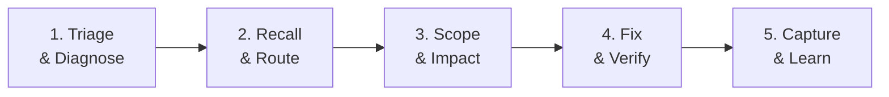

# Kỹ Năng Chẩn Đoán & Sửa Lỗi NRO (Bug-Fix Engine)

> **Nguyên tắc**: *Chẩn đoán trước — sửa sau. Không bao giờ sửa code mù quáng khi chưa hiểu nguyên nhân gốc rễ và blast radius.*

---

## 1. Quy Trình 5 Bước Sửa Lỗi Chuẩn (The 5-Step Bug-Fix Loop)



### Bước 1: Phân Loại & Chẩn Đoán Tự Động (Triage)

Khi nhận bug report, chạy ngay công cụ chẩn đoán phù hợp:

```bash
# Có mô tả triệu chứng? → Chạy pattern matching tự động
python .agents/skills/nro-bugfix/scripts/diagnose.py --symptom "mô tả lỗi"

# Có stacktrace? → Phân tích exception + call stack tự động
python .agents/skills/nro-bugfix/scripts/diagnose.py --stacktrace "paste stacktrace"

# Lỗi liên quan packet/opcode? → So sánh stream Server↔Client
python .agents/skills/nro-bugfix/scripts/stream_diff.py <opcode>

# Lỗi compile Unity CS0117? → Kiểm tra package version
python .agents/skills/nro-bugfix/scripts/diagnose.py --cs0117 "error CS0117: ..."

# Liệt kê tất cả bug patterns đã biết
python .agents/skills/nro-bugfix/scripts/diagnose.py --list-patterns
```

Tool `diagnose.py` sẽ tự động:
- Khớp triệu chứng với **10 bug patterns đã biết** (STREAM_DESYNC, DUPE_BUG, OVERFLOW_INT, NPE_ZONE, UI_FREEZE, GC_PAINT_ALLOC, DB_LEAK, CS0117_UNITY, BOSS_STUCK, OPTION_DUPE)
- Chỉ ra **file cần xem** và **cách sửa pattern**
- Phân tích stacktrace tự động (Java + C#)

### Bước 2: Nhớ Lại Bài Học & Định Tuyến Module (Recall & Route)

```bash
# 2.1 Nhớ lại bài học từ các phiên fix bug trước
python tools/memory/memory.py recall "<mô tả bug>" --files "<file dự kiến>"

# 2.2 Định tuyến nhanh tới module tri thức đúng
python tools/memory/guardrails.py --test-routing "<từ khóa>"
```

Sau khi routing xong, **đọc file GEMINI.md tương ứng** để nạp các bất biến bắt buộc của module đó. Xem [Architecture Map](./references/architecture-map.md) để tra cứu nhanh.

### Bước 3: Đánh Giá Phạm Vi Ảnh Hưởng (Scope & Impact)

**Trước khi sửa bất kỳ method nào**, chạy impact analysis:

```bash
# Ai gọi tới method này? Method này gọi gì?
python .agents/skills/nro-bugfix/scripts/impact.py <File.java> <methodName>

# Ví dụ cụ thể:
python .agents/skills/nro-bugfix/scripts/impact.py NPoint.java calPoint
python .agents/skills/nro-bugfix/scripts/impact.py ItemService.java addItemBag
python .agents/skills/nro-bugfix/scripts/impact.py Controller.cs onMessage
```

Tool sẽ báo:
- **Callers**: Tất cả file/method gọi tới → blast radius
- **Callees**: Các method mà nó phụ thuộc → dependency chain
- **Risk Level**: 🟢 LOW (≤3 callers), 🟡 MEDIUM (4-10), 🔴 HIGH (>10)

Nếu sửa packet (opcode), chạy thêm:
```bash
# So sánh write↔read stream Server↔Client theo từng byte
python .agents/skills/nro-bugfix/scripts/stream_diff.py <opcode>
# Ví dụ: python .agents/skills/nro-bugfix/scripts/stream_diff.py -27
```

### Bước 4: Sửa Có Mục Tiêu & Xác Minh (Fix & Verify)

**Nguyên tắc sửa code:**
- Chỉ mở đúng class và method then chốt (dưới 100 dòng mỗi lần đọc)
- Tuân thủ nghiêm ngặt các bất biến từ GEMINI.md đã nạp ở Bước 2
- Nếu sửa Server Java: đồng thời kiểm tra Client C# counterpart (và ngược lại)

**Xác minh bắt buộc sau khi sửa:**
```bash
# 4.1 Biên dịch Server
build.bat

# 4.2 Quét toàn bộ invariant violations
python tools/memory/guardrails.py --check-all

# 4.3 Nếu sửa packet: Chạy lại stream diff
python .agents/skills/nro-bugfix/scripts/stream_diff.py <opcode>
```

**Checklist tự vấn bắt buộc trước khi báo cáo hoàn thành:**
1. Code có lỗi biên dịch (compile error) không?
2. Nếu sửa packet: thứ tự write↔read có khớp 1:1 không?
3. Nếu sửa Client: có vi phạm Zero-GC trong paint()/update() không?
4. Nếu sửa DB: có dùng try-with-resources không?
5. Nếu sửa Player/NPoint: biến tích lũy có dùng long không?
6. Tệp tài nguyên liên quan (asset) có tồn tại thực trên đĩa không?
7. Thay đổi có gây icon lỗi đỏ trên Unity Console không?

### Bước 5: Đúc Kết Bài Học (Capture & Learn)

Nếu bug phức tạp (>1 lần thử) hoặc phát hiện pattern mới:
```bash
python tools/memory/memory.py capture \
  --files "<file1,file2>" \
  --tags "<tag1,tag2>" \
  --symptom "<Triệu chứng cụ thể>" \
  --cause "<Nguyên nhân gốc rễ>" \
  --rule "<Quy tắc ngăn chặn tái phát>"
```

Nếu áp dụng thành công bài học cũ:
```bash
python tools/memory/memory.py feedback <L_ID> +1
```

---

## 2. Hướng Dẫn Theo Loại Bug

### 🔴 Stream Protocol Desync (Lệch byte Server↔Client)
1. Xác định opcode bị lỗi
2. `stream_diff.py <opcode>` → thấy MISMATCH ở đâu
3. Sửa thứ tự write/read cho khớp 1:1
4. Chạy lại `stream_diff.py <opcode>` → xác nhận PASS

### 🔴 Item Dupe / Mất đồ
1. `diagnose.py --symptom "dupe item trade"`
2. Kiểm tra `synchronized` trong Trade.tradeItem() và CombineService.combine()
3. Kiểm tra DB save atomic (lưu thất bại phải rollback RAM)
4. `impact.py ItemService.java addItemBag` → callers

### 🔴 Tràn Số (Overflow)
1. `diagnose.py --symptom "sức mạnh 0 overflow"`
2. Grep `int hp`, `int dame`, `int sucManh` trong NPoint.java
3. Đổi int → long, cast (long) trước phép nhân
4. Kiểm tra Client Controller.cs đọc readLong() tương ứng

### 🔴 Client Treo / Đen Màn Hình
1. `diagnose.py --symptom "xoay tròn đen màn hình"`
2. Kiểm tra flow InfoDlg.showWait() → sendThongBaoResetWait (opcode -99)
3. Kiểm tra changeMap có đúng zone không (cấm dùng changeMap trong võ đài)
4. Kiểm tra timeout handler trong Session_ME.cs

### 🟡 NullPointerException
1. `diagnose.py --stacktrace "paste trace"`
2. Xác định object null (player.zone?, mob.target?, item.template?)
3. Thêm null-check trước khi truy cập
4. Kiểm tra lifecycle: object có thể bị remove trước khi code chạy tới?

### 🟡 Unity Compile Error (CS0117)
1. `diagnose.py --cs0117 "error CS0117: ..."`
2. Kiểm tra `Client/Client/Packages/manifest.json` → package version
3. Restore: `git checkout HEAD -- Client/Client/Packages/manifest.json Client/Client/Packages/packages-lock.json`
4. Xóa `Library/PackageCache/<package-lỗi>` → mở lại Unity

---

## 3. Tham Khảo Nâng Cao

- [Bug Pattern Database & Decision Tree](./references/bug-patterns.md)
- [Architecture Map & File Routing](./references/architecture-map.md)
- [Memory System (nro-memory skill)](../nro-memory/SKILL.md)

---

## 4. Anti-Patterns: Những Điều KHÔNG Được Làm Khi Fix Bug

1. **KHÔNG grep toàn bộ class lớn mù quáng** — Dùng routing + impact để tìm đúng vị trí
2. **KHÔNG sửa Server mà quên Client** (hoặc ngược lại) — Luôn kiểm tra counterpart
3. **KHÔNG báo cáo hoàn thành khi chưa biên dịch thành công** — `build.bat` + `guardrails.py --check-all`
4. **KHÔNG sửa method có >10 callers mà không đánh giá impact** — `impact.py` trước
5. **KHÔNG giả định asset tồn tại** — Kiểm tra file thực tế trên đĩa trước
6. **KHÔNG nâng warning thành LogError** — Tránh icon đỏ giả trên Unity Console
7. **KHÔNG cấp phát new trong paint()/update()** — Vi phạm Zero-GC gây giật FPS

