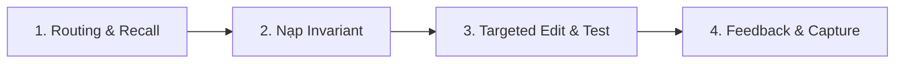

# Kỹ Năng Quản Trị Tri Thức & Học Tăng Cường NRO

> **Nguyên tắc**: Không lặp lại lỗi đã gặp trong quá khứ. Mọi kinh nghiệm từ các phiên sửa lỗi trước đều được ghi nhớ và truy xuất tự động.

---

## 1. Chu Trình 4 Bước Chuẩn (The 4-Step Loop)



### Bước 1: Tra Cứu & Nhớ Lại (Routing & Recall)
Khi nhận yêu cầu từ người dùng, chạy ngay:
```bash
# 1.1 Tra cứu file nguồn liên quan theo từ khóa (hỗ trợ tiếng Việt có dấu)
python tools/memory/guardrails.py --test-routing "<từ khóa yêu cầu>"

# 1.2 Nhớ lại bài học/lỗi tương tự từ các phiên trước
python tools/memory/memory.py recall "<mô tả task hoặc lỗi>" --files "<file dự kiến sửa>"
```

### Bước 2: Nạp Bất Biến Của Module
Đọc file `GEMINI.md` của module được chỉ định:
- Kinh tế / Đập đồ / NPC: `src/services/GEMINI.md`
- Người chơi / Chỉ số: `src/models/player/GEMINI.md`
- Map / Quái / Zone: `src/models/map/GEMINI.md`
- Boss / AI: `src/models/boss/GEMINI.md`
- Võ đài / Giải đấu / Sinh tử: `src/models/tournament/GEMINI.md`
- Nhiệm vụ / Danh hiệu: `src/models/task/GEMINI.md`
- Netty / Packet: `src/network/GEMINI.md`
- Database / DAO: `src/database/GEMINI.md`
- Client Unity C#: `Client/Client/Assets/Scripts/GEMINI.md`

### Bước 3: Sửa Code Mục Tiêu & Kiểm Thử
- Chỉ mở đúng hàm/class cần thiết (dưới 100 dòng).
- Biên dịch kiểm tra: `build.bat` (Server) hoặc soát cú pháp C# (Client).
- Quét vi phạm bất biến:
  ```bash
  python tools/memory/guardrails.py --check-all
  ```

### Bước 4: Đúc Kết & Phản Hồi Tăng Cường (Feedback & Capture)
1. **Nếu áp dụng thành công một bài học từ trước**:
   ```bash
   python tools/memory/memory.py feedback <L_ID> +1 --note "Đã áp dụng hiệu quả cho file X"
   ```
2. **Nếu bài học cũ đã lỗi thời hoặc sai lệch**:
   ```bash
   python tools/memory/memory.py feedback <L_ID> -1 --note "Lý do sai lệch"
   ```
3. **Nếu vừa giải quyết một bug phức tạp (>1 lần thử), phát hiện giả định sai hoặc được User nhắc nhở**:
   ```bash
   python tools/memory/memory.py capture \
     --files "<file1,file2>" \
     --tags "<tag1,tag2>" \
     --symptom "<Triệu chứng cụ thể khi lỗi xảy ra>" \
     --cause "<Nguyên nhân gốc rễ dẫn đến lỗi>" \
     --rule "<Quy tắc hành động ngắn gọn để tránh lặp lại>"
   ```
4. **Xem tổng hợp phiên làm việc**:
   ```bash
   python tools/memory/memory.py digest
   ```

---

## 2. Tiêu Chuẩn Bài Học (Lesson Quality Gate)
- **Triệu chứng (Symptom)**: Cụ thể, có tên lỗi/hiện tượng (ví dụ: *đen màn hình khi đổi zone*, *nhân bản option Cà chua 191*).
- **Nguyên nhân (Root Cause)**: Chỉ rõ lỗi logic (ví dụ: *dùng changeMap thay vì playerMove*, *quên clear list mặc định*).
- **Quy tắc (Rule)**: Khẳng định ngắn gọn, hành động cụ thể, không viết chung chung.
- **Thăng hạng (Promote)**: Khi một bài học đạt score ≥ +2, nó sẽ được nâng cấp thành Invariant chính thức vào file `GEMINI.md`:
  ```bash
  python tools/memory/memory.py promote <L_ID>
  ```
