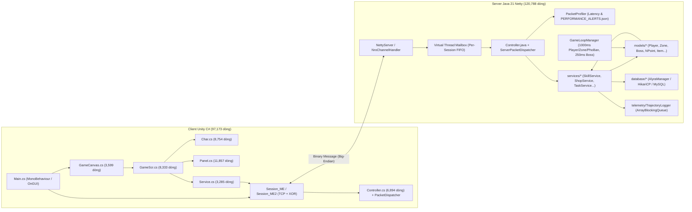

# Báo Cáo Đánh Giá Tổng Quan Kiến Trúc, Hiệu Năng, Gameplay & DevOps (`00_OVERVIEW_ARCHITECTURE.md`)

**Phạm vi kiểm toán**: `853` tệp mã nguồn (`219,125` dòng code) gồm Server Java 21 Netty (`596` file, `120,788` dòng), Client Unity C# (`247` file, `97,173` dòng) và Tooling/Test (`10` file, `1,164` dòng).  
**Phương pháp**: Kết hợp phân tích tĩnh toàn dự án (`00_INDEX_SUMMARY.md`, `04_dependency_matrix.json`, `digest_arch_perf_gameplay.json`) và xác minh trực tiếp (spot-check) tại các điểm nóng mã nguồn.

---

## 1. Kiến Trúc Tổng Thể Server Java 21 Netty & Client Unity C#

### 1.1. Sơ Đồ Luồng Xử Lý Chính

### 1.2. Các God Classes & Độ Phình Mã Nguồn

Hệ thống bị chi phối bởi các lớp nguyên khối (God Classes) ôm đồm cả logic nghiệp vụ, mạng, lưu trữ và hiển thị:

| Thành phần | Tệp nguồn | Số dòng | Số method | Vai trò & Vấn đề |
| :--- | :--- | ---: | ---: | :--- |
| **Client UI** | `Client/.../Panel.cs` | 11,857 | 250 | Trộn lẫn ~30 màn hình UI, input, render, animation; `ISubPanel` mới chỉ ủy quyền `Paint` còn logic vẫn nằm ở `Panel`. |
| **Client Entity** | `Client/.../Char.cs` | 8,754 | 186 | Trộn dữ liệu nhân vật, vật lý tile, túi đồ, skill state machine, thú cưỡi và `paint()`. |
| **Client World** | `Client/.../GameScr.cs` | 8,333 | 184 | Giữ ~100+ biến `static` (HUD, auto-play, entity vectors, RMS loaders) không reset sạch khi `clearGameScr()`. |
| **Client Network** | `Client/.../Controller.cs` | 6,894 | 32 | `onMessage` dài ~4,520 dòng với 2 khối `switch` lồng nhau (gây chết nhánh `case 66` trùng lặp). |
| **Client Outbound** | `Client/.../Service.cs` | 3,285 | 154 | Singleton tạo mọi gói tin, tự chuyển đổi `Session_ME` / `Session_ME2` tạm thời. |
| **Server Consts** | `src/consts/ConstTask.java` | 6,359 | 0 | Sinh sẵn 6,336 hằng số `TASK_X_Y` thay vì dùng hàm bit-shift. |
| **Server Services** | `src/services/Service.java` & `TaskService.java` | 2,385 / 2,425 | - | Gom hàng chục chức năng giao tiếp packet, UI menu, nhiệm vụ vào một lớp. |

### 1.3. Ma Trận Phụ Thuộc & Coupling (`04_dependency_matrix.json`)

- **Phụ thuộc vòng chéo nghiêm trọng (Cyclic Dependencies)**:
  - `models -> services`: **818** imports, trong khi `services -> models`: **332** imports.
  - `models -> server`: **66** imports, trong khi `server -> models`: **50** imports.
  - `services -> server`: **48** imports, trong khi `server -> services`: **61** imports.
  - `database -> models` (**55**) và `models -> database` (**16**), `database -> services` (**13**) và `services -> database` (**31**).
- **Kế thừa sai & Trùng lặp (Duplication)**:
  - Trên Client: `BigBoss.cs`, `BigBoss2.cs`, `BachTuoc.cs`, `NewBoss.cs` sao chép ~500 dòng logic của `Mob.cs` và dùng từ khóa `new` che khuất method/field thay vì `override`, khiến gọi qua tham chiếu `Mob` bị sai lệch trạng thái.
  - Trên Server: `XENCON1-7`, `Yardart` (18 subclass), `NamekGinyuForce`, `MajinBuu12H/14H` sao chép code hàng loạt; tồn tại song song stack Socket cũ (`Network.java`, `Session.java`) bên cạnh Netty 4; `ServerPacketDispatcher` mới tách được 2 opcode (`-86`, `-20`) trong khi `Controller.java` vẫn giữ nhánh chết tương ứng.

---

## 2. Đánh Giá Hiệu Năng CPU / RAM / GC (Server + Client)

### 2.1. Phía Server Java 21
- **Điểm tích cực**: `GameLoopManager.java` đã tách nhịp cập nhật hợp lý: `1000ms` cho Player/Zone/Phó Bản/Event Boss và `250ms` cho Combat Boss; có cơ chế giảm tải `5000ms` cho các `Zone` không có người chơi (`zone.getPlayers().isEmpty()`).
- **Điểm nghẽn & Rò rỉ (P1/P2)**:
  1. **I/O đồng bộ trên Netty IO Thread (`PacketProfiler.java:202-249`)**: Khi gói tin vượt ngưỡng `criticalThreshold`, `triggerPerformanceAlert()` giữ khóa `synchronized` toàn cục và gọi `syncAlertsJson()` ghi thẳng ra đĩa (`tools/memory/PERFORMANCE_ALERTS.json`) ngay trên luồng xử lý gói tin.
  2. **Rò rỉ bộ nhớ không giới hạn (Unbounded Heap Leak)**:
     - `Item.ItemOption.OPTION_STRING` (`src/models/item/Item.java:118-122`) là `ConcurrentHashMap` tĩnh cache mọi chuỗi `name#param#` không có cơ chế eviction/LRU.
     - `TrajectoryLogger.playerTickMap` (`src/telemetry/TrajectoryLogger.java:41, 119-121`) lưu `AtomicLong` theo `playerId` nhưng không xóa khi người chơi thoát game.
  3. **Chi phí `CopyOnWriteArrayList` trong `Zone.java` (`Zone.java:53-58, 213-218`)**: Mỗi `Zone` khởi tạo 6 `CopyOnWriteArrayList` (`nonInteractiveNPCs`, `humanoids`, `notBosses`, `players`, `bosses`, `pets`). Mọi thao tác vào/ra map của người chơi/pet/boss đều sao chép toàn bộ mảng nội bộ.
  4. **DoS vòng lặp đồng bộ (`PhaLeHoaTrangBi.java:137-188`)**: `startCombineVip` không giới hạn số lần lặp `n` từ client gửi lên, có thể khóa luồng xử lý của nhân vật hàng trăm triệu vòng lặp.
  5. **Truy vấn DB đồng bộ trên luồng game**: `Clan.getPlayerOnline()` (`Clan.java:238-251`) fallback sang `NDVSqlFetcher.loadById()` khi người chơi offline; `SuperRankService` và `WhisArenaBotManager` chạy N+1 query đồng bộ; `ResultSetImpl` copy toàn bộ kết quả JDBC vào cả `List<Map<String, Object>>` lẫn `List<Object[]>` gây áp lực GC lớn.

### 2.2. Phía Client Unity C#
- **Vi phạm nghiêm trọng bất biến Zero-GC trong `paint()` / `update()`**:
  - `mFont.cs:392-446`: Cấp phát `new Color[6]` và `new Color[7]` (qua `bigColor()`) trên **mỗi khung hình** khi vẽ sát thương/chữ viền ở `zoomLevel > 1`.
  - `Char.cs:4698-4719, 1922-2367`: Nối chuỗi (`strMount + ... + "_0"`, `charID + string.Empty`), cấp phát `new Effect(...)`, `new MyVector()`, `new EffectPaint[]` liên tục; đặc biệt `paintMount1/2` gọi `checkLoadMount()` và `MyStream.readFile("/Mob/50")` **đọc đĩa/texture đồng bộ ngay trong hàm `paint()`**.
  - `GameScr.cs` & `Panel.cs` & `ClientManager.cs`: `GameScr.paint()` thay đổi state/timer và cấp phát `new ClanImage()`, `string[]`, `int[]`; `ClientManager.GUI()` gọi `Utils.getItemFromName("bông tai")` tạo chuỗi `.ToLower()` cho toàn bộ túi đồ mỗi frame; `Panel.paint*` nối chuỗi và gọi `splitFontArray` liên tục cho mọi dòng không culling theo `cmy`.
- **Giật khung hình (Frame Hitch) & Rò rỉ Native Memory**:
  - `Panel.setTabMap()` (`Panel.cs:4020-4021`), `Controller.loadInfoMap()`, `TileMap.freeTilemap()` gọi `Resources.UnloadUnusedAssets(); GC.Collect();` đồng bộ trên Main Thread.
  - `Image.createImage(Image)` cấp phát `Texture2D` mới rồi ghi đè tham chiếu `img.texture` mà không `Destroy`, gây rò rỉ GPU/native memory.
  - `Session_ME2.MessageCollector.run()` gọi `Thread.Sleep(5)` sau mỗi gói tin nhận, giới hạn tốc độ tải tài nguyên xuống tối đa 200 gói/giây.
  - `Main.OnGUI()` gọi `Input.GetMouseButton*` trên mọi event pass (`Layout`, `Repaint`...) thay vì chỉ xử lý trong `Update()` hoặc lọc `Event.current.type`.

---

## 3. Đánh Giá Gameplay Logic & Cân Bằng

Qua kiểm toán và xác minh trực tiếp, nhiều lỗi nghiêm trọng (P0/P1) đang làm sai lệch công thức sát thương, kinh tế và cơ chế Boss/Skill:

| Hệ thống | Vị trí mã nguồn | Lỗi & Tác động thực tế | Mức độ |
| :--- | :--- | :--- | :---: |
| **Chỉ số (NPoint)** | `src/models/player/NPoint.java:927-933` | `calPercent()` chia cho **`150`** thay vì `100` (cả bản `long` và `int`). Mọi chỉ số phần trăm trang bị/buff chỉ đạt **66.7%** giá trị thật. | **P0** |
| **Skill Đặc Biệt** | `src/models/player/NewSkill.java:51-55` | Dùng phép gán `if (this.isStartSkillSpecial = true)` thay vì `==`, khiến `updateSkillSpecial()` chạy liên tục ngay cả khi đã đóng skill. | **P0** |
| **Boss Yardart** | `src/models/boss/boss_list/Yardart/Yardart.java:249-262` | Sau `hsChar()` hồi đầy máu, dòng 253 ghi đè `this.nPoint.hp = 1`, khiến mọi đòn đánh tiếp theo đều kích hoạt `reward(plAtt)` -> **farm vô hạn item 590**. | **P0** |
| **Skill Trị Thương** | `src/services/SkillService.java:852-875` | Dòng 857 kiểm tra `canHsPlayer(player, plTarget)` thay vì `pl` (hồi máu cho cả địch trong 300px); dòng 872-873 hồi máu bản thân nằm trong vòng lặp `for (players)` -> **nhân bội lượng hồi theo số mục tiêu**. | **P0** |
| **Vật phẩm / Rương** | `src/services/func/useitem/handlers/ChestBoxItemHandler.java:122-185,249-260` | `openWoodChest` không cập nhật `lastTimeRewardWoodChest` (mở vô hạn); `open1427` không kiểm tra `quantity >= 99` trước khi trừ (1 mảnh chế Trứng Rồng). | **P0** |
| **Kỹ năng & PvP** | `SkillService.java:429-443, 699-720` | `Kaioken` ép kiểu `Util.maxIntValue()` làm cụt HP > 2.14 tỷ về `Integer.MAX_VALUE`; `HuytSao` buff và trừ 10% HP người chơi Namec trung lập (`cFlag == 0`) ở map thường. | **P1** |
| **Đệ tử & Set Đồ** | `Pet.java:722-735`; `SetClothes.java:140-182` | `Pet.followMaster` so sánh `disX < 50` không lấy `Math.abs()` gây spam gói tin di chuyển khi đứng bên trái chủ; `SetClothes` dùng `break` thay vì `continue` khi gặp ô đồ trống, làm mất kích hoạt set. | **P1** |
| **Boss & Phó Bản** | `SieuBoHung.java`, `Drabura2.java`, `Cadic.java`, `BiMa.java`, `SnakeWay.java` | `SieuBoHung.handleBom` truyền `plAtt = null` (mất thưởng/nhiệm vụ); `Drabura2` reset `damage = 0` nên bất tử/không rơi đồ; `Cadic` né 100% (`Util.isTrue(..., 1)`); `Halloween` boss chia `damage / 1`; `SnakeWay` tràn số `int` HP Cadich từ level >= 114. | **P1** |
| **Client UI & Input** | `GameCanvas.cs:699-729, 2463`; `GameScr.cs:7735`; `Panel.cs:9046, 10314` | `panel.updateKey()` gọi 2 lần/tick; phím 15 bị kẹt `keyHold[15] = true` khi nhả phím; `chatVip` bắt đầu bằng `!` văng `ArgumentOutOfRangeException`; nút Back đổi cờ (`10031`) đóng kết nối `Session_ME`. | **P1** |

*(Lưu ý xác minh: Cảnh báo trùng tên trường `SIEU_THAN_THUY` tại `ConstItem.java:200` và `730` trong digest là **FALSE POSITIVE** — dòng 200 là `SIEU_THANH_THUY` có chữ `H`, dòng 730 là `SIEU_THAN_THUY` không có `H`, biên dịch hoàn toàn bình thường).*

---

## 4. Đánh Giá DevOps, Tooling, Telemetry & Testing

### 4.1. Điểm Mạnh: Hệ Sinh Thái Loop Engineering & Telemetry
1. **Cổng Kiểm Tra Biên Dịch (`tools/compile_check.py`)**: Tự động hóa hoàn chỉnh việc biên dịch chéo cả Client Unity C# (dùng Roslyn `csc.dll` với các assembly Unity 2022.3 + .NET 4.8) và Server Java 21 (`javac -encoding UTF-8`), là cổng kiểm soát bắt buộc trước khi hoàn tất tác vụ.
2. **Hệ Thống Trí Nhớ & Guardrails (`tools/memory/`)**:
   - Quản lý bài học lịch sử (`LESSONS.jsonl`), định tuyến file nhanh (`CODE_ROUTING.json`), quét vi phạm tự động (`guardrails.py`, `violation_scanner.py`, `VIOLATIONS_BASELINE.json`), và cảnh báo hiệu năng (`PERFORMANCE_ALERTS.json`).
3. **Pipeline Telemetry AI (`src/telemetry/`)**:
   - `TrajectoryLogger` sử dụng `ArrayBlockingQueue` (Ring Buffer non-blocking) kết hợp `AntiMacroFilter` và thread nền `AI-Trajectory-Flusher` ghi batch `.jsonl`, tránh block trực tiếp Game Loop (chỉ còn thiếu cơ chế dọn `playerTickMap` khi logout).

### 4.2. Điểm Yếu & Rủi Ro Vận Hành
- **Thiếu Test Framework chuẩn & Cô lập môi trường (`tools/test/`, `test/`)**:
  - Các bài test đều là script `main()` thủ công, chưa tích hợp JUnit/NUnit hay CI/CD tự động.
  - `tools/test/TestProfilerEngine.java` (dòng 135-221) ghi trực tiếp vào tệp production `tools/memory/PERFORMANCE_ALERTS.json` và `logs/metrics/` thay vì thư mục tạm.
  - `test/TestWhisArenaLogic.java` chứa assertion phụ thuộc thời gian thực (`"101 phút nữa"`).
- **Mã thử nghiệm / debug sót trong Production**:
  - `src/testddos/DdosTester.java` (mở 5,000 socket không đóng tới `127.0.0.1:14445`) nằm ngay trong cây `src/` production.
  - `WhisArenaService.TEST_MODE_24_7 = true` đang bật cứng.
  - Client `Image.loadData` gọi `Debug.LogError` cho luồng tải ảnh bình thường gây đỏ Unity Console.

---

## 5. Tổng Kết & Chấm Điểm

| Khía Cạnh Đánh Giá | Điểm (/10) | Nhận Định Cốt Lõi |
| :--- | :---: | :--- |
| **1. Kiến trúc (Architecture)** | **4.5 / 10** | Netty 4 + Virtual Thread tốt ở tầng mạng, nhưng God Classes (11.8k dòng) và phụ thuộc vòng chéo (`models <-> services`) gây rủi ro bảo trì rất cao. |
| **2. Hiệu năng CPU/RAM/GC** | **4.0 / 10** | Server còn ghi file đồng bộ trên IO thread, `CopyOnWriteArrayList` dày đặc và leak cache; Client vi phạm nặng Zero-GC và đọc đĩa/gọi `GC.Collect()` khi vẽ. |
| **3. Gameplay Logic & Cân bằng** | **3.5 / 10** | Nhiều bug P0 chí mạng (`calPercent / 150`, `Yardart hp=1`, `TRI_THUONG`, `ChestBoxItemHandler`, `NewSkill = true`) ảnh hưởng trực tiếp công bằng và kinh tế game. |
| **4. DevOps, Tooling & Testing** | **6.5 / 10** | Tooling nội bộ (`compile_check.py`, `tools/memory/`, `TrajectoryLogger`) rất ấn tượng, nhưng thiếu CI/CD, unit test cô lập và còn sót code test trong `src/`. |
| **Trung bình tổng thể** | **4.6 / 10** | **Cần ưu tiên vá ngay các lỗi P0 Gameplay/Economy, tách I/O khỏi luồng render/network, và từng bước giải thể God Classes.** |
